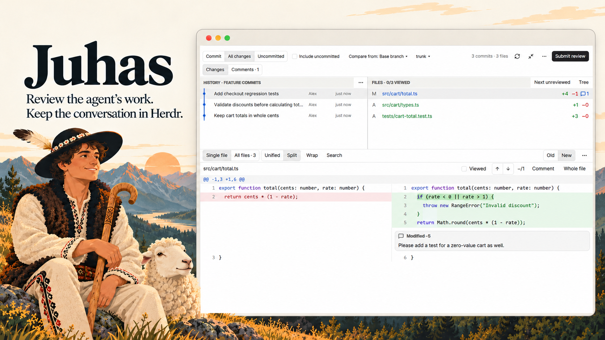
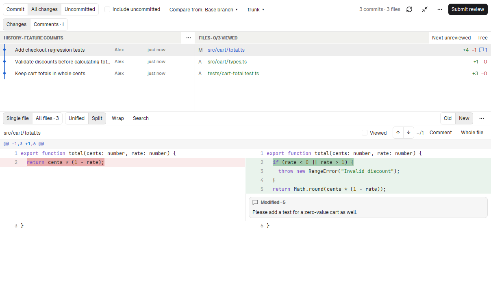

# Juhas - Code review

Review your agent's changes in Herdr.

Review commits one by one, see a branch's combined changes, or inspect
uncommitted work. Comment beside the code, then send your feedback to the
coding agent in one review.



*A native Juhas review with sample data, presented alongside an illustration.*

## Review workflow

- Review commits one at a time when each covers a separate change. For commits
  that keep revising the same code, use **All changes** to see the combined diff
  against your base branch, a chosen commit or your last review checkpoint.
- Comment on a line, a range or a whole file. Drafts keep their original source
  when you move to another commit.
- Collect comments from several commits into one review. Check the recipient,
  edit or copy the message, then send it to your agent when you're ready.
- Mark a reviewed commit as seen. After the agent makes more changes, compare
  from that checkpoint to review the next round.

Use the sidebar for a quick look, or expand into a dedicated review tab with Git
history, a file list or tree, and a full-width Unified or Split diff. Resize the
panels to fit the code, and use change navigation to move through the diff.
Loading indicators show when Git is still working.

Juhas uses Herdr’s native GPUI controls. It works with local Git repositories
and agent terminals; no GitHub account or pull request is required. Base-branch
rules are yours to configure, with no built-in team conventions.

## A closer look



*A real native review view, using sample code and comments.*

## Install

You need **Herdr App 0.1.11 or later**, Git and **Node.js 22+** for the installer.
The running mod uses Herdr’s built-in JavaScript runtime and does not need Node.
Native UI verification currently covers Windows; core tests also run on Linux
and macOS.

Clone or download this repository, then run from its root:

```sh
node scripts/install.mjs
```

The installer copies the mod and backs up an existing installation without
changing layouts, toolbar mods or review data. Open a native pane:

```sh
herdr-app do pane.split --direction right --mod juhas
```

Juhas follows the project where you open it. Expand opens or reuses a review
tab for that exact repository/worktree within the space. The review tab keeps
its source when you work in another terminal. The return icon moves the review
back to the source sidebar, preserving the selected commit, file and unsaved
comment. With the optional toolbar integration, clicking Juhas on the source tab
focuses its existing review tab; clicking Juhas in that review returns to the sidebar.

## Your first review

1. Open **Juhas** in the project you want to review. Expand when you want more room.
2. Stay in **Commit** to inspect individual commits, or choose **All changes**
   for the final result. Choose a base branch if one has not been configured.
3. Choose **Uncommitted** for working files, or enable **Include uncommitted**
   in All changes to review commits and later fixes together. Click the code,
   write feedback and save with **Enter** (**Shift+Enter** adds a new line). Comments can come from
   several commits and still go into one review.
4. Choose **Submit review**. Check the recipient and message, then **Send review**
   or **Copy**. Unsaved comments offer an explicit Save / Skip / Back choice.

**Mark seen** is separate from sending feedback. It records the exact displayed
commit as a checkpoint; it does not approve changes or silently mark newer work
as reviewed.

## Local by default, deliberate when sending

Juhas sends no telemetry. Browsing reads Git locally; **Fetch** contacts your
configured remotes only when you request it. **Send review** deliberately sends
the preview text to the selected terminal.

Drafts and edited previews stay in your Herdr home. Checkpoints use private Git
refs and do not change your branch, index or working tree. Comments keep their
original revisions and line ranges; outdated feedback is marked rather than
silently moved to another line. Full code quotes and Git headers are optional.

Visible reviews check for changes every 15 seconds without jumping away from
your selected commit/file. Unchanged sources reuse cached data. Viewed markers,
find in loaded code, optional wrapping and All files support longer reviews.
General feedback needs no file anchor. Save working snapshot explicitly records
uncommitted contents as a local baseline; background checks never take snapshots.

The author reports successful review delivery to a coding agent in real use.
A send acknowledgement means the terminal accepted the message, not that the
agent finished the changes. Uncertain deliveries retain drafts and are not
retried automatically. See [local data and delivery](docs/usage.md#local-data-and-delivery)
for the details and current limits.

## Why “Juhas”?

A *juhas* is a shepherd working with the *baca*, the head shepherd in the Polish
mountain tradition. Herdr has a flock; Juhas helps you keep an eye on the work
coming back from your coding agents. You choose the base branches and layout for your own projects.

## Credits and license

Inspired by the Herdr community’s
[Git graph](https://github.com/rabeeh-ta/herdr-git-graph),
[reviewer](https://github.com/vytasgavelis/herdr-reviewer) and
[agent review](https://github.com/jkuepker/herdr-mods/tree/main/agent-review) mods.
The implementation uses Herdr, gpui-kit and gpui-base from your installation.
Bundled **Lucide** icons retain their ISC/MIT notices.

Juhas is licensed under [Apache 2.0](LICENSE). See [NOTICE](NOTICE) and
[third-party notices](THIRD_PARTY_NOTICES.md).

Maintainers: see the [publication guide](docs/publishing.md),
[verification record](docs/acceptance.md) and [design brief](docs/design-brief.md).

To add the Juhas button to an unmodified personal tabs copy, run
`node scripts/install.mjs --tabs <personal-tabs-mod>`. To upgrade an existing
Juhas toolbar integration, use `--update-tabs <personal-tabs-mod>` instead.
Both options back up the personal tabs mod and leave layout files untouched.
