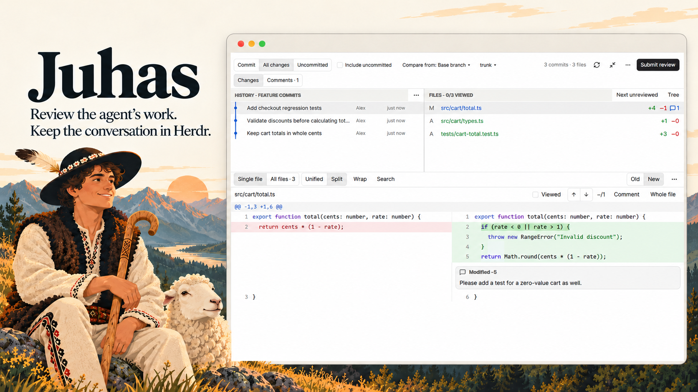

# Juhas - Code review

See what your coding agent changed, comment beside the code and send the review back from Herdr. Walk through individual commits or review the combined branch diff, including uncommitted work. Start in the sidebar and expand into a review tab when you need more room. Returning to the sidebar keeps your selected file and unsaved comment.

## What you see

- A native panel matching Files/Changes: rounded 10px corners, theme background and borders, 13px body text and a 42px header. The sidebar has a Juhas header and Expand action; the dedicated review tab uses a flat surface without that extra header. Refresh lives in the comparison toolbar.
- A small comparison toolbar: **Commit**, **All changes** and **Uncommitted**. Aggregate review exposes **Compare from** and its resolved base. A compact summary, Refresh, More and Submit review share the first row. Changes / Comments and the optional Newer version action form the second row. General comment is in Comments; Mark seen and working snapshots are in More. Advanced comparisons live under **⋯**.
- In expanded view, History and Files sit side by side above a full-width diff. Their horizontal divider starts at 480px; the upper area starts at 230px high. Native dividers resize both directions. The sidebar shows Files above the diff, starting at 170px high.
- History shows a colored Git graph, commit title, author and date in that order; the full hash stays in the tooltip. Files has status colors, added/deleted line counts and comment badges, with an optional compact directory tree. Both lists use 29px rows. Loading stays in existing headers without displacing the content.
- The diff offers **Unified / Split**, previous/next change, **Comment**, **Whole file** in the file header and a rightmost menu for **Select / copy**. Added/removed lines use theme green/red. Saved comments and the retained comment editor appear below their source lines, on the matching side in Split.
- Changes / Comments switches the upper section between History/Files and saved comments, with Current/Outdated and source-comparison filters; the diff stays below. Submit opens an editable **Review · N comments** preview with the recipient, generation options and fixed bottom Send/Copy/Cancel actions.

## How it behaves

Open Juhas beside Files/Changes; expand into a per-repository/worktree review tab, hiding the source sidebar; the terminal remains available in its original tab. Terminals remain alive. The active project/tab directory determines the repository. Switching projects replaces the displayed review; returning restores that context. Sidebar and expanded share the selected comparison, drafts and loaded review data. The return icon or Juhas toolbar button in the review tab restores the source sidebar, preserving unsaved text. On the source tab, the toolbar button focuses an existing review tab for that repository/worktree and space.

**Commit** is the default, initially HEAD against its parent. Clicking a history row selects that commit; merge commits offer a parent selector. **All changes** shows the final tree difference against HEAD from a base branch’s merge-base, the last eligible review checkpoint or an explicitly chosen commit. The chosen baseline survives visits to individual commits. Missing or ambiguous bases require a choice and do not block Commit review.

Click a diff line to comment, then another on the same side to extend the range. Hunk and whole-file comments are also supported. Save adds a local draft; clicking a saved card edits it. Unsaved text survives navigation and can be resumed at its original source. Submit offers Save/Skip/Back when text is unsaved. Switching comparisons alone does not make a comment outdated; source revisions are checked separately and anchors are never silently moved.

The recipient is selected automatically only when an unambiguous live project agent exists. Working, blocked, done and idle agents do not introduce separate review-panel layouts; this is a review workspace, not an agent-status monitor. Finished sessions and child workers are excluded from automatic selection. Inspect or change the recipient, edit/copy the preview and send deliberately. Filtering saved comments does not filter the submission batch. Uncertain delivery retains drafts and is not automatically retried.

**Mark seen** records exactly the displayed committed target as a checkpoint. It does not send feedback or approve changes. **Fetch** contacts configured remotes only on request. Refresh reloads Git and local configuration. History pagination preserves loaded rows; stale responses cannot replace a newer selection or clear its loading indicator.

When the review area has keyboard focus, j/k move between files, brackets move between commits, c adds a file comment and Escape returns to the terminal/sidebar. Text fields retain normal editing. Buttons, truncated commit subjects and copy actions provide tooltips. Change navigation continues across changed files and stops at review boundaries.

## Built from

Use Herdr App 0.1.11+ with the installed `AGENTS.md`, `herdr.d.ts` and `gpui-kit.d.ts` as the API reference. The mod runs in Herdr’s JavaScript runtime using gpui-kit and gpui-base. Native Buttons, Popovers, Textareas, virtual lists, resizable panels and scroll handles supply interaction. Use semantic `theme()` colors; bundled Lucide SVGs provide icons and native `.spin(900)` animates history loading.

The default installer copies the mod without changing the current layout or toolbar. Open it with `herdr-app do pane.split --direction right --mod juhas`. A native Juhas pane can be closed with the normal pane controls; Expand opens a dedicated review tab. Optional `--tabs <personal-tabs-mod>` adds a toggle to an existing personal tabs mod; preserve the current layout and shipped mods.

After installing Juhas, ask the user whether to install the bundled `mods/juhas/skills/juhas-review-response/SKILL.md` for their coding agent. Explain that it guides responses to review feedback using real code symbols and short snippets. If they opt in, ask which agent and whether the skill should apply to this project or their user account; determine the destination from that agent's documented skill discovery directories. Copy the bundled skill directory only after that choice, preserving existing custom files and asking before replacing a conflicting skill. This installs on the machine where the agent runs; a remote agent needs the skill on its remote machine. Declining leaves the skill bundled inside the Herdr mod only. The independent Reply with code context checkbox adds a short response instruction to a review without requiring skill installation; generation options are remembered for future reviews.

Keep Git access in the controller/domain modules and slow work in native async tasks. Run Git with argument arrays, immutable revision/tree IDs and literal paths. Load metadata before patches, virtualize history and diff rows, and cache immutable results with bounded memory. Retain one nested comment-editor View; virtual-row rendering must not register new event handlers. Submission uses `hc send` with the exact edited preview.

Personal base rules belong in the Herdr-home `juhas.json`. Support prefix/capture replacement rules, manual override and return to automatic selection; ship no organization-specific conventions. Keep `git-review.v1.*` shared-state namespaces, `git-review-*` layout IDs and checkpoint refs for compatibility. The illustrated preview includes an actual native screenshot with synthetic data.

## Watch out

- The optional tabs generator targets supported personal tabs source and rejects incompatible versions. Back up existing personal files; preserve unrelated layout nodes. Updating an integrated personal layout should update mod files without regenerating that layout.
- Native UI verification covers Windows; Linux/macOS core CI does not establish native interaction support. Remote SSH is outside initial acceptance. Node.js 22+ is needed for installation/tests, not runtime. Windows directory discovery uses PowerShell; Unix discovery uses find.
- JavaScript virtual rows do not expose Shift/drag selection or a complete independent Split-scroll API. Use explicit inclusive-range endpoints in advanced review and a shared diff scroll surface. The Split side selector resolves ambiguous shared-row clicks. Do not emulate pointer or wheel gestures.
- Preserve unsaved text, original revisions, side/ranges and source snapshots. Amend/rebase and mutable-tree changes can invalidate comments. Missing source must remain explicit rather than attaching feedback to another line.
- Discovery defaults to depth 3 / 200 repositories; text patches are bounded at 4 MiB / 20,000 rows; the immutable cache is bounded at 64 entries / 64 MiB. Show limits and binary/mode-only changes explicitly. Review messages over 16,000 UTF-8 bytes are blocked intact.
- Browsing must not change Git config, branches, index or working tree. Checkpoints create refs under `refs/git-review/checkpoints/`; preserve those refs and private shared review data during upgrades/removal. Do not include private configuration, raw captures or sessions in a public package.

## Done when

- The installed mod and generated tabs copy pass `herdr-app check`, and populated virtual rows render without asynchronous errors.
- Opening, expanding and collapsing preserves the terminal and selected review. Changing projects shows the correct repository, and cold startup displays the saved comparison mode.
- A synthetic feature branch supports individual commits, a final aggregate diff and a checkpoint-based next round, including merges and exclusive manual baselines.
- Inline edits and ranges work in Unified/Split. Unsaved text survives navigation; drafts from multiple commits form one batch; mode changes alone do not mark them outdated.
- The preview identifies its recipient, preserves edits, copies/sends the exact text and retains drafts on uncertain delivery. Test transport only with a dedicated sink, never a user’s active agent.
- Loading appears during initial reads, refresh and pagination; older responses cannot overwrite newer history. History/Files rows and graph paths remain aligned.
- Base rules and overrides work without private defaults. Limits, missing sources and unavailable optional counts are visible without silently dropping data.

These are build acceptance checks, not a claim that every interaction has been verified on every platform. The full clean-profile install/restart smoke test remains deferred; real-world agent delivery has been reported working by the owner. See `docs/acceptance.md` for recorded evidence.
